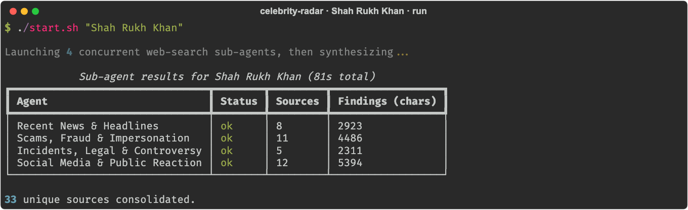
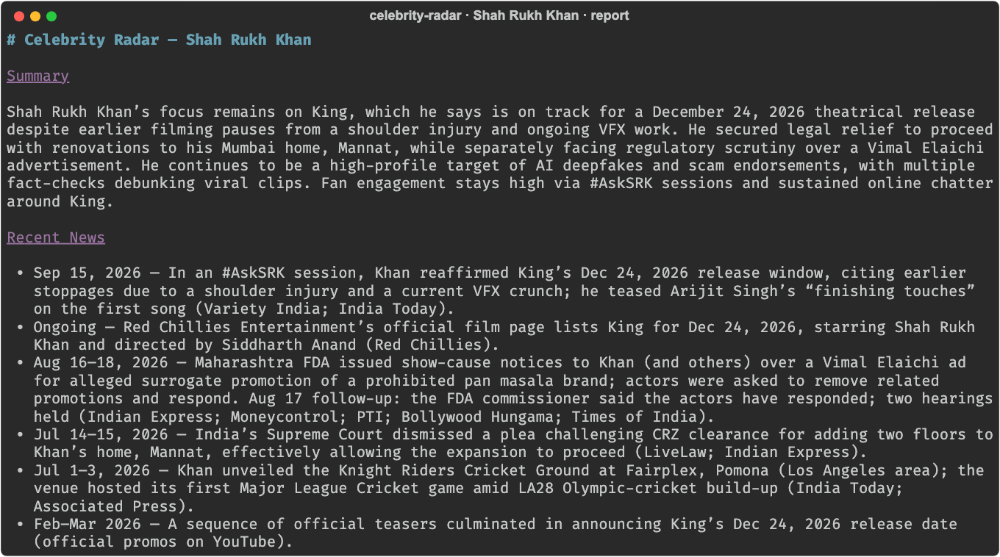
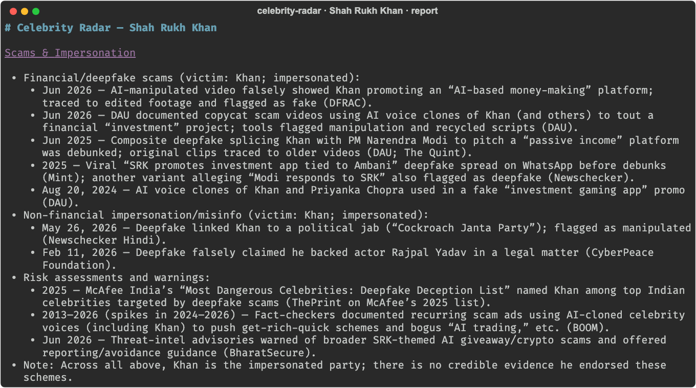
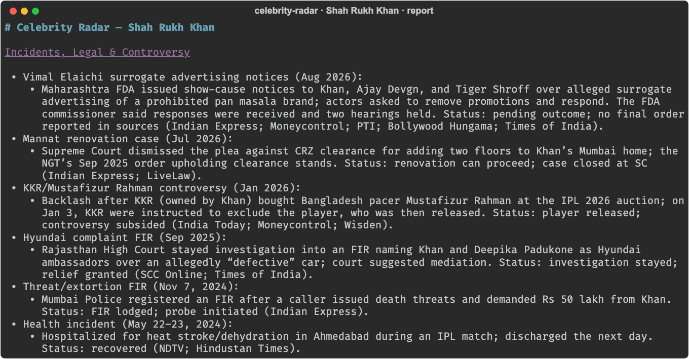
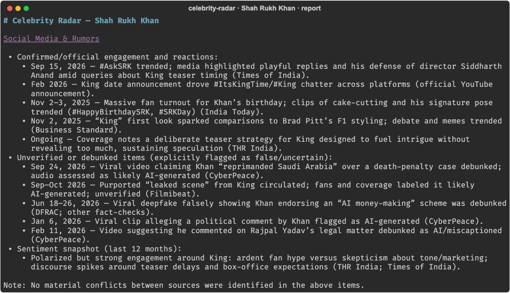
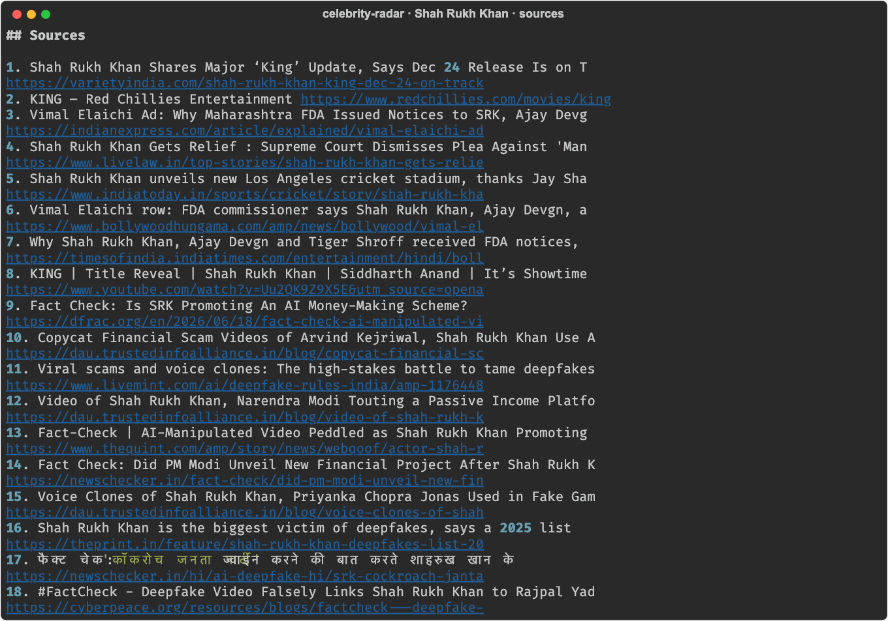
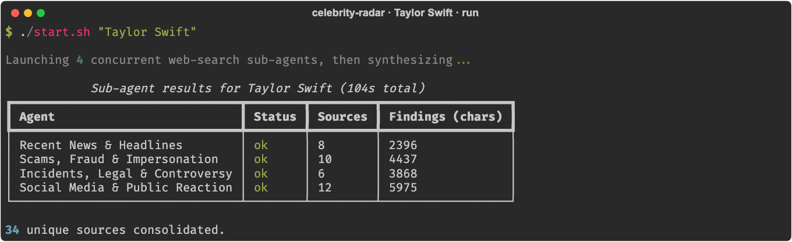
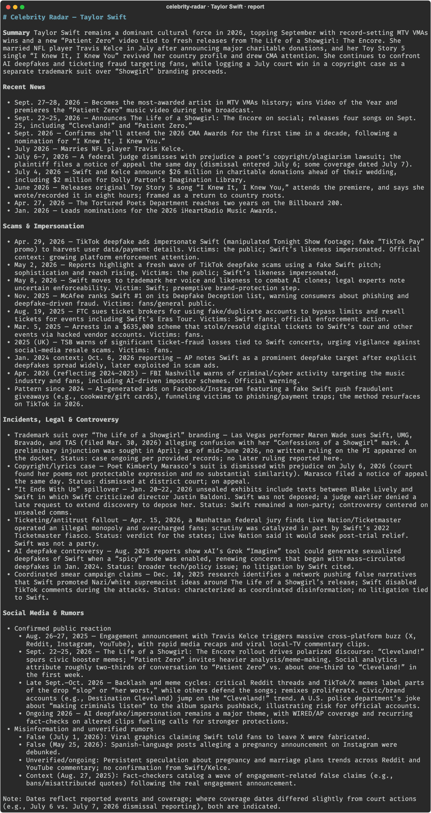
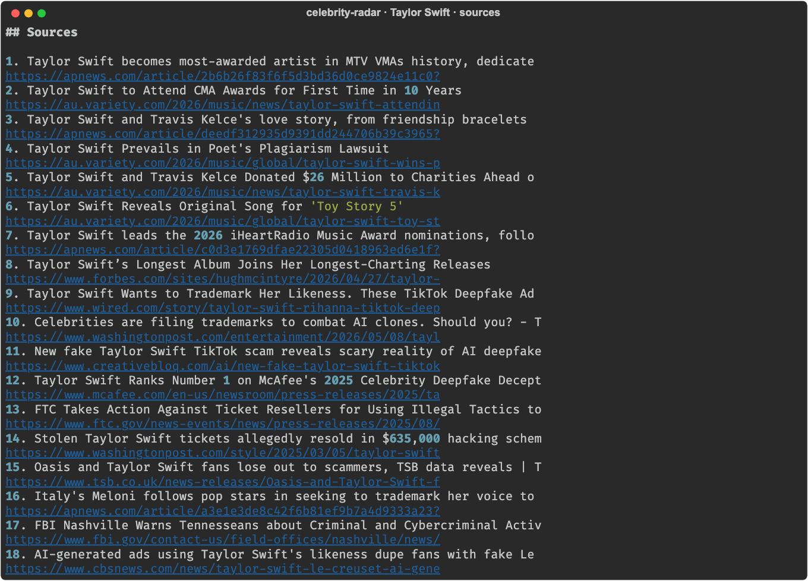

# Celebrity Radar Agent

A multi-agent research CLI. Give it a celebrity or public figure and it fans out
to **four specialist web-search agents running concurrently**, then an
orchestrator model synthesizes their findings into one Markdown briefing with a
consolidated source list.

- **Language:** Python 3.12
- **LLM:** OpenAI Responses API with the built-in `web_search` tool
- **Search loop:** runs server-side at OpenAI; each sub-agent is a single call
- **Config:** everything comes from `.env`

## How it works

``` 
                  ┌─ Recent News & Headlines ───────┐
celebrity name ──▶├─ Scams, Fraud & Impersonation ──┤──▶ orchestrator ──▶ Markdown report
                  ├─ Incidents, Legal & Controversy ┤    (synthesis)      + sources
                  └─ Social Media & Public Reaction ┘
                       (concurrent, asyncio)
```

1. Each sub-agent gets the same celebrity name but a different focus (see
   `DEFAULT_AGENTS` in [`config.py`](celebrity_radar/config.py)) and returns
   findings plus the URL citations it relied on.
2. The orchestrator merges the findings into a report with these sections:
   **Summary**, **Recent News**, **Scams & Impersonation**,
   **Incidents, Legal & Controversy**, **Social Media & Rumors**.
3. Sources from all agents are de-duplicated by URL.
4. If one sub-agent fails, the others still complete and the report notes the gap.

## Screenshots

Real runs of the agent. Each image is the actual output rendered in a terminal style.

### Shah Rukh Khan


*Run overview: four sub-agents, sources found per agent*


*Report: summary and recent news*


*Report: scams and impersonation*


*Report: incidents, legal and controversy*


*Report: social media and rumors*


*Consolidated sources*

### Taylor Swift


*Run overview*


*Report*


*Consolidated sources*

## Project layout

```
celebrity_radar/
  __main__.py      CLI entry point (python -m celebrity_radar)
  config.py        Models (from .env) and the sub-agent roster
  subagent.py      One web-search sub-agent (Responses API call + source extraction)
  orchestrator.py  Concurrent fan-out + synthesis -> CelebrityReport
requirements.txt
.env.example
setup.sh / start.sh
```

## Setup

Requires Python 3.12.

```bash
./setup.sh                 # creates .venv, installs deps, copies .env.example -> .env
# then edit .env and set OPENAI_API_KEY
```

## Run

```bash
./start.sh "Shah Rukh Khan"
./start.sh "Taylor Swift" -o report.md     # also save the report to a file
```

Or directly:

```bash
source .venv/bin/activate
python -m celebrity_radar "Taylor Swift"
```

A run takes roughly 1 to 2 minutes, since each sub-agent performs live web searches.

## Configuration

All settings come from `.env` (see `.env.example`):

| Variable | Purpose | Default |
| --- | --- | --- |
| `OPENAI_API_KEY` | OpenAI API key | required |
| `OPENAI_MODEL` | Model for orchestrator and sub-agents (must support `web_search`) | `gpt-5` |
| `ORCHESTRATOR_MODEL` | Optional override for the synthesis step | `OPENAI_MODEL` |
| `SUBAGENT_MODEL` | Optional override for the search sub-agents | `OPENAI_MODEL` |

To add, remove or re-scope sub-agents, edit `DEFAULT_AGENTS` in
`celebrity_radar/config.py`. A `SearchAgentSpec` can also restrict a sub-agent
to a list of `allowed_domains`.

## Notes

- Output is built from live web search and a language model. Treat it as a lead
  to verify, not a source of record, especially for rumors and legal matters.
- The report separates confirmed facts from unverified claims, and says whether
  the celebrity is a victim or being impersonated in scam cases.

---

Author: Rahul Singh Bana · bana.saa@gmail.com · [LinkedIn](https://www.linkedin.com/in/rahulsinghbana) · [Repo](https://github.com/rahulbana/rahulbana)
